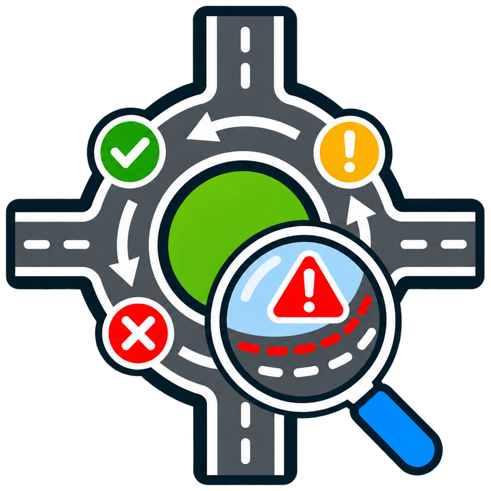

  
  <h1>RoundaboutCircularAnalyzer</h1>
  
Find potential tagging and geometry issues in OpenStreetMap roundabouts and circular junctions.

  
<a href="https://atarom.github.io/RoundaboutCircularAnalyzer/"><strong>Open the analyzer ↗</strong></a>

---

RoundaboutCircularAnalyzer analyzes OpenStreetMap ways tagged `junction=roundabout` or `junction=circular` to identify possible issues with circulation direction, mixed junction types, suspicious tagged nodes and unclosed geometries. Explore results by category or connected group, inspect ways in OpenStreetMap and choose a custom Overpass API server that is remembered in your browser.

## Technologies and data

- [OpenLayers](https://openlayers.org/) — WebGL vector rendering and map navigation.
- [OpenStreetMap contributors](https://www.openstreetmap.org/copyright) — map tiles and geographic data under the ODbL.
- [Overpass API](https://wiki.openstreetmap.org/wiki/Overpass_API) — OSM data queries.
- [Nominatim](https://nominatim.org/) — place search.

Run locally with `python3 -m http.server 8000` from the repository directory and open `http://localhost:8000/`.
